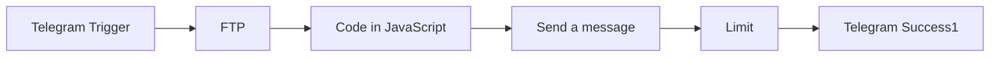

# Telegram to HR Email (CV)

n8n workflow that turns a Telegram message into job-application emails. Paste one or more email addresses into Telegram. The workflow downloads your CV, sends one email per address, and replies in Telegram when it is done.

Workflow file: [`telegram-to-hr-email.json`](telegram-to-hr-email.json)

## What you send

Message the connected Telegram account with any text that contains email addresses. Separators do not matter. Commas, spaces, line breaks, and extra words are all fine.

```text
hr@company.com, jobs@company.com
talent@company.com
```

## What gets sent

Each address receives one Gmail message:

- **Subject:** Software Engineer Application – Omar Alshareef
- **Body:** a short HTML note saying you are looking for a software engineering or development role, with the CV attached
- **Attachment:** `files/OmarAlshareef_cv.pdf`, downloaded over SFTP and sent as the binary field `cv`
- **Links in the email:** [omaralshareef.com](https://www.omaralshareef.com/), plus LinkedIn and GitHub buttons

The LinkedIn and GitHub buttons still point at the placeholders `YOUR_LINKEDIN_URL` and `YOUR_GITHUB_URL`. Replace those in the Gmail node before you rely on them.

After the emails go out, Telegram gets one reply: `✅ Emails are all sent`.

## Flow

```text
Telegram Trigger → FTP → Code in JavaScript → Send a message → Limit → Telegram Success1
```

The sticky note sits on the canvas only. It is not part of the run.



## Nodes

### 1. Telegram Trigger

Listens for new Telegram **message** updates on **Telegram account omar**.

When a message arrives, the rest of the workflow starts. Later nodes read that message in two places: the text (to find email addresses) and the sender id (to send the success reply back to the same chat).

### 2. FTP

Downloads the CV over SFTP using **SFTP account**.

| Setting | Value |
| --- | --- |
| Protocol | SFTP |
| Path | `files/OmarAlshareef_cv.pdf` |
| Saved as | binary property `cv` |

The file on the server has to stay at that path. Every email in the same run uses this one download.

### 3. Code in JavaScript

Reads the Telegram message and prepares one item per recipient.

1. Takes the message text from **Telegram Trigger**.
2. Finds anything that looks like an email, no matter how the text is split.
3. Drops addresses that fail a structure check:
   - whole address longer than 254 characters
   - local part missing, longer than 64 characters, starting or ending with `.`, or containing `..`
   - domain with fewer than two labels
   - a domain label that is empty, longer than 63 characters, contains anything other than letters, digits, and hyphens, or starts or ends with `-`
4. Removes duplicates without caring about letter case. `HR@Company.com` and `hr@company.com` count as one address.
5. Copies the CV binary from **FTP** onto every item.

The output of each item is `{ email }` plus the `cv` file. If the message has no valid address, this node returns nothing, and no email is sent.

### 4. Send a message

Sends the application through **Gmail account 3**.

| Setting | Value |
| --- | --- |
| To | `{{ $json.email }}` from the code node |
| Subject | Software Engineer Application – Omar Alshareef |
| Body | HTML application note |
| Attachment | binary property `cv` |
| n8n attribution | off |

n8n runs this node once for each item from the code node, so five unique addresses produce five emails. Each one carries the same CV.

### 5. Limit

Sits after Gmail and has no custom settings, so it keeps n8n’s default: the **first item only**.

Gmail has already sent every email by this point. Limit stops the success reply from firing once per recipient. One Telegram confirmation covers the whole batch.

### 6. Telegram Success1

Replies in the same Telegram chat that started the run.

| Setting | Value |
| --- | --- |
| Chat | sender id from **Telegram Trigger** |
| Text | `✅ Emails are all sent` |
| n8n attribution | off |
| Credential | **Telegram account omar** |

### Sticky Note

Canvas label only: “Email Assistant — write the email in Telegram.” Nothing connects to it, and it does not run.

## Credentials

Importing the JSON does not copy secrets. On the n8n instance, reconnect these three credentials:

- **Telegram account omar** on Telegram Trigger and Telegram Success1
- **SFTP account** on FTP
- **Gmail account 3** on Send a message

## Import

1. In n8n, import `telegram-to-hr-email.json`.
2. Attach the three credentials above.
3. Confirm `files/OmarAlshareef_cv.pdf` is on the SFTP server.
4. Replace `YOUR_LINKEDIN_URL` and `YOUR_GITHUB_URL` in the Gmail HTML.
5. Activate the workflow and send a Telegram message that contains at least one email address.
